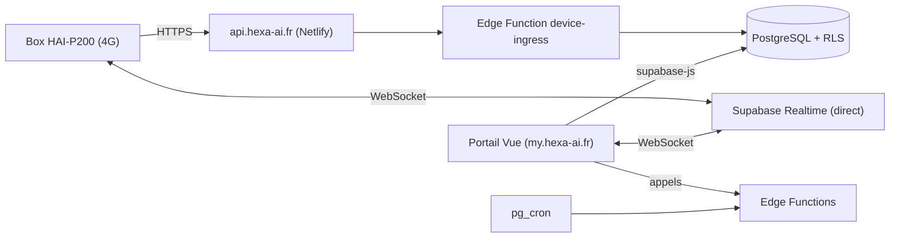

# myHexa — le portail client d'Hexa-AI

myHexa est le portail web de [Hexa-AI](https://hexa-ai.fr). Il permet aux clients (et à l'équipe Hexa) de **superviser des box industrielles 4G (HAI-P200)** : état de connexion, mesures, alarmes, historique, tableaux de bord, rapports par mail, mises à jour à distance.

- Production : <https://my.hexa-ai.fr>
- Les box envoient leurs données à <https://api.hexa-ai.fr> (relais Netlify vers la fonction `device-ingress`, voir `netlify.toml`).

## En deux phrases

Le **front** (`app/`) est une application Vue 3 hébergée sur Netlify. Le **back** (`supabase/`) est une base PostgreSQL protégée par des règles RLS, plus des Edge Functions (Deno) et des tâches planifiées. Il n'y a pas d'autre serveur.



## Démarrage rapide

Prérequis : Node 20 ou plus (Netlify et la CI utilisent 20 ; les commandes ci-dessous ont été vérifiées en Node 22) et pnpm 10.

```bash
cd app
npx -y pnpm@10 install --frozen-lockfile   # dépendances
cp .env.example .env.local                 # puis renseigner les variables VITE_* (voir ci-dessous)
npx -y pnpm@10 dev                         # serveur de développement (vite)

npx -y pnpm@10 typecheck                   # vérification des types (vue-tsc --noEmit)
npx -y pnpm@10 test:unit                   # tests unitaires (vitest run)
npx -y pnpm@10 build                       # vue-tsc -b && vite build → app/dist
```

Variables de build du front (fichier `app/.env.example`) :

| Variable | Rôle |
|---|---|
| `VITE_SUPABASE_URL` | URL du projet Supabase visé |
| `VITE_SUPABASE_ANON_KEY` | clé publique « anon » de ce projet |
| `VITE_EDGE_FUNCTIONS_URL` | URL de base des Edge Functions (se termine par `/functions/v1`) |
| `VITE_CARTO_API_KEY` | fond de carte (facultatif) |

Il existe deux projets Supabase : **TEST** (pour essayer) et **PROD** (les clients). Leurs références ne sont pas dans cette documentation : elles sont dans la configuration locale de l'équipe.

> **Piège connu** : sans `VITE_EDGE_FUNCTIONS_URL`, `app/src/lib/api.ts` lève une erreur dès son import, donc `tests/unit/lib/api.spec.ts` ne se charge pas. En local, mettez des valeurs factices pour lancer les tests (voir [`docs/exploitation/README.md`](docs/exploitation/README.md)). Ce fichier contient en plus 4 tests qui échouent déjà (ils testent des fonctions supprimées).

## Carte de la documentation

Tout est dans [`docs/`](docs/README.md). Ordre conseillé pour un nouveau développeur :

1. [`docs/glossaire.md`](docs/glossaire.md) — le vocabulaire (box, variable, direct, synoptique…).
2. [`docs/architecture.md`](docs/architecture.md) — la vue d'ensemble avec schémas.
3. [`docs/flux/`](docs/flux/) — comment les données circulent (ingestion, direct, position, météo, alertes, partage, grille des tableaux de bord, synoptique).
4. [`docs/front/`](docs/front/README.md) — le code de `app/src` et comment ajouter un écran.
5. [`docs/backend/`](docs/backend/) — tables, droits (RLS), fonctions SQL, Edge Functions.
6. [`docs/exploitation/`](docs/exploitation/README.md) — environnements, migrations, déploiement, tests, retour arrière.

Documents plus anciens, toujours utiles : [`docs/device-provisioning.md`](docs/device-provisioning.md) (contrat des box), [`docs/reference/status-payload-schema.md`](docs/reference/status-payload-schema.md) (format du statut), [`docs/realignement-prod-2026-10.md`](docs/realignement-prod-2026-10.md) (réalignement de la prod), [`supabase/cron-setup.md`](supabase/cron-setup.md) (tâches planifiées).

## Organisation du dépôt

```
app/                 front Vue 3 + TypeScript + Vite + Tailwind 4 + shadcn-vue + Pinia
  src/               code (voir docs/front)
  tests/unit/        tests vitest
supabase/
  migrations/        schéma SQL, RLS, fonctions SQL, planifications (l'ordre = le nom de fichier)
  functions/         Edge Functions Deno + _shared/
  tests/             scripts de test (Python et SQL) pour le projet TEST
  email-templates/   modèles de mails d'authentification
  config.toml        configuration Supabase
docs/                documentation (ce guide)
netlify.toml         build du front, relais api.hexa-ai.fr, en-têtes de sécurité
.github/workflows/   CI (typecheck, lint, tests, build)
```

## Règles d'or

- **Aucun secret dans le dépôt** (il est public). Les secrets des fonctions sont des variables d'environnement Supabase ; la documentation ne les cite que par leur nom.
- Une modification de la base = **une nouvelle migration** dans `supabase/migrations/` (on n'édite pas une migration déjà appliquée).
- Le droit d'accès aux données est décidé **dans la base (RLS)**, pas dans le front. Le front ne fait que masquer des boutons.
- Ne pas « corriger » la compatibilité firmware de `device-ingress` sans lire [`docs/flux/ingestion.md`](docs/flux/ingestion.md).
