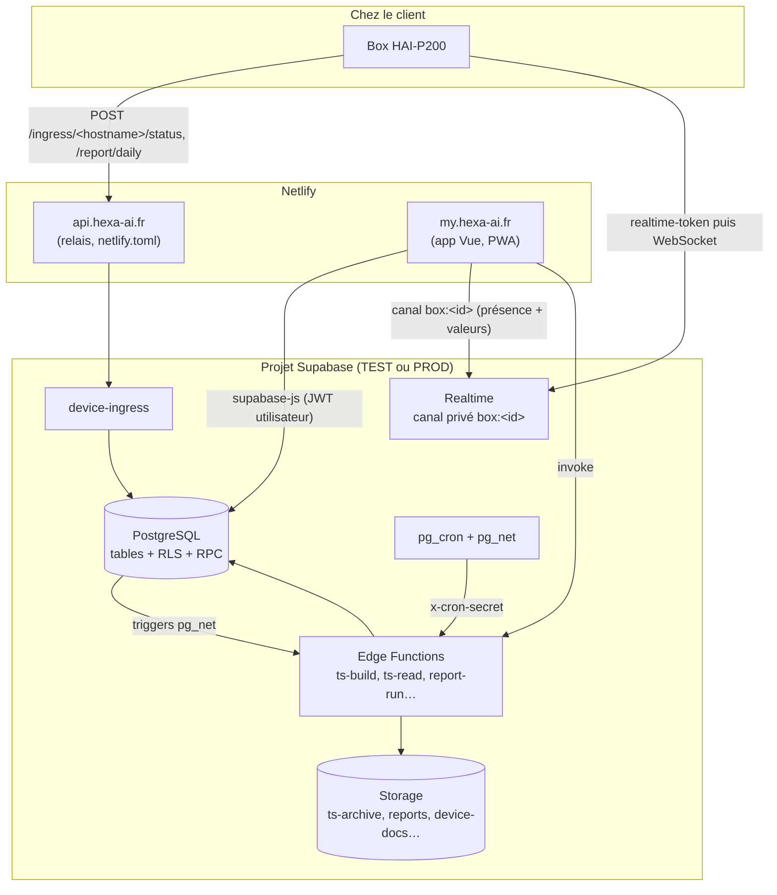
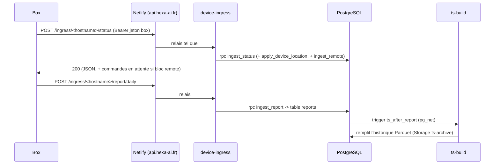
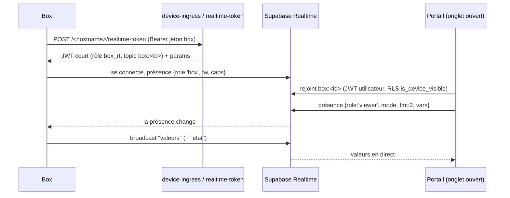
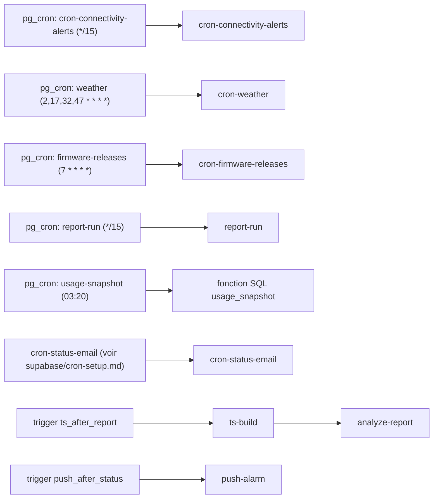

# Architecture

## Les quatre briques

| Brique | Où | Rôle |
|---|---|---|
| Box HAI-P200 | chez le client | collecte les mesures de l'automate, les envoie en 4G |
| Front (portail) | `app/`, hébergé sur Netlify | interface web et PWA |
| Base PostgreSQL | `supabase/migrations/` | données, droits (RLS), fonctions SQL |
| Edge Functions | `supabase/functions/` | code serveur (Deno) : réception des box, mails, rapports, historique |

Il y a deux projets Supabase identiques en structure : **TEST** et **PROD**. Le front est construit une fois par environnement, avec les variables `VITE_*` du projet visé.

## Vue d'ensemble

## Chemin des données d'une box (ingestion)

Détail : [flux/ingestion.md](flux/ingestion.md).

## Le direct temps réel

Détail : [flux/temps-reel.md](flux/temps-reel.md).

## Tâches planifiées et déclencheurs

Les planifications des quatre premières lignes et de `usage-snapshot` sont créées par des migrations (`20261029220000_cron_connectivity.sql`, `20261030090000_meteo.sql`, `20261029210000_versions_depot.sql`, `20261024130000_report_templates_proto.sql`, `20261028150000_consommation.sql`). `cron-status-email` est décrit dans `supabase/cron-setup.md` (mise en place à la main). Un cron horaire pour `ts-build` est mentionné dans l'en-tête de `supabase/functions/ts-build/index.ts` mais **aucune migration ne le crée** : il est à vérifier dans le projet cible (`select * from cron.job`).

Les URL des fonctions et le secret des crons sont lus dans le **Vault** Supabase par les tâches (noms de secrets Vault comme `ts_build_url`) ; voir [exploitation](exploitation/README.md).

## Netlify

`netlify.toml` fait quatre choses :

1. construit le front (`base = "app"`, `pnpm install --frozen-lockfile && pnpm build`, publie `dist`) ;
2. **relaie** `https://api.hexa-ai.fr/*` vers la fonction `device-ingress` (règles `status = 200`, donc transparentes pour la box ; elles doivent rester **avant** la règle `/*` de l'application) ;
3. renvoie toute autre URL de `my.hexa-ai.fr` vers `/index.html` (application monopage) ;
4. ajoute des en-têtes de sécurité (`X-Frame-Options: DENY`, etc.) et interdit le cache de `sw.js` et `manifest.webmanifest`.

## Les rôles d'utilisateurs

Voir [backend/securite-rls.md](backend/securite-rls.md). En résumé : **staff Hexa** (admin d'une entreprise marquée `is_hexa_internal`) voit tout ; **admin** d'entreprise gère son entreprise ; **viewer** consulte ; un destinataire peut aussi recevoir des **box partagées** d'une autre entreprise.

## Où est le code de chaque chose ?

| Je cherche… | Fichier |
|---|---|
| les écrans et les URL | `app/src/router/index.ts`, `app/src/views/` |
| la session et les rôles côté front | `app/src/stores/auth.ts`, `app/src/router/guards.ts` |
| les appels à la base | `app/src/composables/use*.ts` |
| l'appel des Edge Functions | `app/src/lib/api.ts` (`callEdge`) |
| le direct | `app/src/stores/live.ts`, `app/src/lib/live/` |
| la réception des box | `supabase/functions/device-ingress/index.ts` + fonctions SQL `ingest_*` |
| les règles d'accès | `supabase/migrations/*` (`create policy`, `is_device_visible`…) |

## Hérité / mort à connaître

- L'ancien flux **n8n** (ingestion, alertes de connectivité, mail de statut) a été remplacé par des Edge Functions. Il en reste des traces : le préfixe d'URL `/ingress/...` et la réponse `{"message":"Workflow was started"}` dans `device-ingress` sont gardés **exprès** pour le firmware.
- Les fonctions `view-report`, `recover-link`, `location-update` et la table `report_tokens` n'existent plus (la table est supprimée par la migration `20260520195717_drop_report_tokens.sql`). Le test `app/tests/unit/lib/api.spec.ts` les cite encore : voir [exploitation](exploitation/README.md).
- `docs/realignement-prod-2026-10.md` liste des fonctions mortes qui seraient encore déployées en prod.
