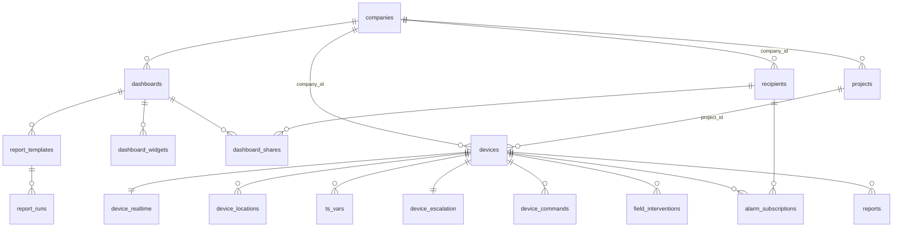

# Modèle de données

Source de vérité : les **74 migrations** de `supabase/migrations/` (ordre = nom de fichier, qui commence par un horodatage). Cette page résume le schéma `public` table par table. Pour les colonnes exactes, lisez la migration indiquée.

> Les types générés `app/src/types/supabase.ts` sont **en retard** sur ce schéma (ils ne décrivent qu'une partie des tables).

Types énumérés : `report_type` ('status', 'daily', 'weekly'), `status_email_frequency` ('none', 'daily', 'weekly'), `device_command_state` ('queued', 'sent', 'in_progress', 'acked', 'failed', 'cancelled').
Extensions : `pg_cron`, `pg_net` (`20260520200417_enable_pg_cron_and_pg_net.sql`), plus le Vault de Supabase pour les secrets des tâches planifiées.

## Cœur : entreprises, personnes, box

| Table | Rôle | Colonnes notables | Migration |
|---|---|---|---|
| `companies` | un client | `is_hexa_internal` (true = l'équipe Hexa), `status_email_frequency`, `status_email_weekday`, `status_email_ai`, `connectivity_alerts_enabled`, `connectivity_delay_minutes`, `max_daily_reports`, `max_weekly_reports`, `logo_path` | `20260419115620_init_haios`, puis `…companies_*`, `…notifications_entreprise`, `…branding_pdf_proto` |
| `recipients` | personne d'une entreprise | `company_id`, `role` ('viewer'/'admin'), `auth_user_id` (→ `auth.users`), `restrict_to_devices uuid[]` (limite à certaines box), `shared_devices uuid[]` (box d'autres entreprises), `portal_access`, `alarm_enabled`, `alarm_channels`, `alarm_schedule_days`, `status_email` | `init_haios`, `add_role_to_recipients`, `add_auth_to_recipients`, `recipients_split_device_access`, `alarm_recipients_proto` |
| `devices` | une box | `company_id`, `name`, `serial_number`, `mac_eth0`, `token` (jeton de la box, unique), `last_connection_at`, adresse et `latitude/longitude`, `vnc_host/port`, état de pilotage à distance (`running_version`, `candidate_version`, `reboot_required`, `update_running`, hachages de listes), `project_id`, parc (`fleet_status`, `delivered_at`, `warranty_months`…), `alerts_paused_until`, position (`location_source`, `location_accuracy_m`, `location_at`) | `init_haios` + nombreuses migrations |
| `reports` | un message reçu d'une box | `device_id`, `type` (`status`/`daily`/`weekly`), `payload jsonb`, `derived_payload`, `period_start/end`, `received_at` | `init_haios`, `derived_integrals`, `manual_reports_periods…` |

Un `report` de type `status` est le **dernier** statut 30 min : il y en a **une seule ligne par box**, remplacée à chaque statut (`ingest_status`, `on conflict (device_id) where type = 'status'`). L'historique des statuts n'est donc pas dans `reports` mais dans `ts_buffer` puis dans les fichiers Parquet. Les rapports journaliers, eux, s'accumulent. La fonction `devices_with_latest_status` expose le dernier statut de chaque box.

## Alarmes, notifications, pilotage

| Table | Rôle | Migration |
|---|---|---|
| `alarm_subscriptions` | qui reçoit les alarmes de quelle box (`filters`, `channels_override`, identifiant court `box_recipient_id` de 8 hex) | `20261023090000_alarm_recipients_proto` |
| `device_escalation` | configuration d'escalade d'une box (`config`, `baseline`) | idem |
| `device_commands` | file des commandes descendantes (`type` : `set_recipients`, `set_escalation`, `run_update`, `reboot`, `send_snapshot`…, `state`, `acked_at`, `ack_status`) | idem |
| `alarm_dismissals` | alarmes « retirées » à la main par un utilisateur | `20261029230000_alarmes_retirees` |
| `push_subscriptions` | abonnements Web Push par utilisateur (`endpoint`, `p256dh`, `auth`) | `20261027090000_push_alarmes` |
| `push_alarm_queue` | alarmes à notifier par push (`sent_at`, `result`) | idem |
| `connectivity_alerts` | dernier état notifié par box (`lost`/`recovered`) | `20260520193135_manual_connectivity_alerts` |
| `connectivity_subscriptions` | qui reçoit les alertes de connectivité de quelle box | `20261029190000_notifications_entreprise` |
| `report_insights`, `device_period_stats` | résultats de l'analyse de dérive (`analyze-report`) et statistiques par période | `20260522092111_report_insights` |
| `recipient_device_views` | dernière consultation / acquittement des « insights » par destinataire | idem, `…insights_popup_snooze` |
| `field_interventions` | signalements / interventions saisis depuis le QR code (`kind`, `category`, `severity`, `status`, `photo_paths`) | `20260515134139_field_interventions` + suites |
| `device_documents` | documents liés à une box (bucket `device-docs`), `is_public` | `20260525053409_device_documents_v2` |

## Historique (séries temporelles)

| Table | Rôle |
|---|---|
| `ts_vars` | catalogue des variables par box (`unit`, `first_day`, `last_day`, `best_res`) |
| `ts_files` | index des fichiers Parquet (niveaux `raw`, `1m`, `1h`, `1d`, et `events`), chemin dans le bucket `ts-archive` |
| `ts_buffer` | tampon des statuts 30 min en attente d'être versés dans le Parquet |
| `ts_dirty` | jours à (re)construire par `ts-build` |
| `ts_build_lock` | verrou de construction par box |

Tout vient de `20261024100000_ts_history_parquet.sql` (verrou : `20261025160000_ts_build_verrou.sql`, événements d'alarme : `20261025100000_alarm_events_parquet.sql`).

## Tableaux de bord, projets, rapports

| Table | Rôle | Migration |
|---|---|---|
| `projects` | regroupement de box d'une entreprise (nom unique par entreprise) | `20261024110000_projects_proto` |
| `project_devices` | box d'autres entreprises placées dans un projet (partage) | `20261028120000_partage_tableaux` |
| `dashboards` | tableau de bord : `scope` ('device', 'project', 'custom'), `device_id`/`project_id`/`device_ids`, `period`, `is_default`, `live_display` | `20261024120000_dashboards_proto`, `20261031100000_dashboards_live_display` |
| `dashboard_widgets` | blocs : `type`, `width`, `sources` (`[{device, var}]`), `op`, `options`, `position` | idem |
| `dashboard_shares` | tableau partagé avec un destinataire | `20261028120000_partage_tableaux` |
| `report_templates` | rapport programmé à partir d'un tableau (`frequency`, `send_hour`, `tz`, `recipient_ids`, `next_run_at`, `attach_csv`, `attach_pdf`) | `20261024130000_report_templates_proto` |
| `report_runs` | une exécution : `status` ('sent', 'not_sent', 'error'), `trigger`, chemins HTML/CSV/PDF | idem |

## Parc, usage, divers

| Table | Rôle | Migration |
|---|---|---|
| `fleet_settings` | réglage unique (garantie par défaut en mois) | `20261024150000_parc_proto` |
| `device_events` | journal des modifications d'une box (acteur, changements) | idem |
| `usage_daily` | consommation par jour et par box (fichiers, octets, rapports) | `20261028150000_consommation` |
| `firmware_releases` | versions du paquet firmware vues dans le dépôt APT | `20261029210000_versions_depot` |
| `weather_sites` | météo par site (coordonnées arrondies) | `20261030090000_meteo` |
| `device_realtime` | trace du dernier jeton direct délivré à une box | `20261031090000_realtime_direct` |
| `device_locations` | historique des positions 4G | `20261031110000_position_box` |

## Stockage (buckets)

| Bucket | Public ? | Contenu | Migration |
|---|---|---|---|
| `intervention-photos` | non | photos des interventions, chemin `{device_id}/{intervention_id}/<i>.<ext>` | `20260515135345` |
| `device-docs` | non | documents des box | `20260525053409` |
| `ts-archive` | non | fichiers Parquet de l'historique | `20261024100000` |
| `reports` | non | HTML / CSV / PDF des rapports envoyés | `20261024130000` |
| `branding` | **oui** (png/jpeg, 2 Mo max) | logos d'entreprise | `20261024140000` |

## Hérité / supprimé

- `report_tokens` : supprimée (`20260520195717_drop_report_tokens.sql`).
- `recipients.allowed_device_ids` : supprimée (`20260520195316_recipients_auth_required.sql`), remplacée par `restrict_to_devices` et `shared_devices`.
- Le type `report_type` garde `weekly`, mais `device-ingress` ignore désormais les rapports hebdomadaires et mensuels.
- Plusieurs migrations portent « `_proto` » dans leur nom : ce sont des prototypes **déjà en production** ; le suffixe est historique.
- Les migrations `20260514…`–`20260528…` ont été « recopiées telles quelles » de la prod lors du réalignement d'octobre 2026 (voir `docs/realignement-prod-2026-10.md`).
