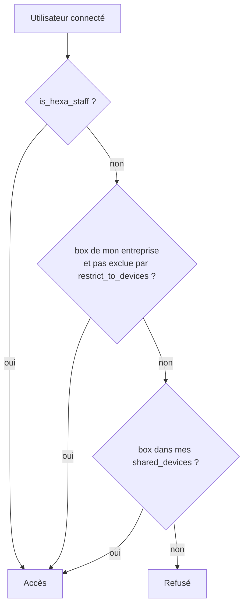

# Droits d'accès : rôles et RLS

Principe : **le front n'est jamais une barrière**. Les données sont protégées par la RLS de PostgreSQL (65 politiques `create policy` réparties dans 27 migrations environ). Les gardes du routeur (`app/src/router/guards.ts`) ne servent qu'à orienter l'utilisateur.

## Les rôles

| Rôle | Définition | Ce qu'il voit / fait |
|---|---|---|
| **Staff Hexa** | `is_hexa_staff()` : destinataire `role = 'admin'` d'une entreprise dont `is_hexa_internal = true` (`20260520204551_is_hexa_staff_admin_only.sql`) | tout, toutes entreprises ; outils `staff/*` |
| **Admin d'entreprise** | `recipients.role = 'admin'` | gère ses destinataires, ses box, ses tableaux et rapports, via `can_manage_company(p_company)` (`20261024110000_projects_proto.sql`) |
| **Viewer** | `recipients.role = 'viewer'` | consulte les box de son entreprise (ou la liste restreinte `restrict_to_devices`) |
| **Destinataire avec partage** | `recipients.shared_devices` contient des box d'une autre entreprise, ou un tableau est partagé (`dashboard_shares`) | voit uniquement ces box / ces tableaux |
| **Visiteur sans compte** | rôle `anon` | aucune fonction SQL ; lecture de documents marqués publics seulement ; peut appeler `submit-intervention` (fonction publique) |
| **Box** | pas un utilisateur : jeton `Bearer` géré par `device-ingress` (fonctions SQL `security definer` appelées avec la clé de service) | écrit ses statuts / rapports ; pour le direct, rôle de base `box_rt` |

Un viewer d'Hexa n'a **aucun** privilège spécial : seul l'admin d'une entreprise interne est staff (commentaire de `20260520204551_is_hexa_staff_admin_only.sql`).

## Les fonctions d'aide à la RLS

Toutes sont `security definer` avec `search_path = public`.

| Fonction | Rôle | Défini dans |
|---|---|---|
| `is_hexa_staff()`, `is_hexa_staff_admin()` | staff Hexa | `…is_hexa_staff_helpers`, `…is_hexa_staff_admin_only` |
| `current_recipient_company_id()`, `current_recipient_is_admin()` | entreprise et rôle de l'utilisateur courant | migrations `rls_*` / `…tenant` |
| `is_device_visible(d_id)` | staff, OU même entreprise (sans dépasser `restrict_to_devices`), OU box dans `shared_devices` | `20260520193136_devices_rls_unified.sql` |
| `can_manage_company(p_company)` | staff, OU admin de cette entreprise | `20261024110000_projects_proto.sql` |
| `can_view_dashboard(p_id)` | staff, OU tableau de son entreprise dont **toutes** les box sont visibles, OU tableau partagé | `20261028120000_partage_tableaux.sql` |
| `recipient_sees_devices(p_recipient, p_devices)` | un destinataire donné voit-il toutes ces box ? | idem |
| `device_shared_with_company(p_device, p_company)` | la box est-elle partagée à un destinataire de cette entreprise ? | idem |
| `is_dashboard_shared_with_me(id)`, `dashboard_read_grant`, `dashboard_share_valid` | partage de tableaux | idem |
| `rt_topic_device(topic)` | extrait l'identifiant de box d'un topic Realtime `box:<uuid>` | `20261031090000_realtime_direct.sql` |

## Schéma de décision (lecture d'une box)

La plupart des tables liées à une box (`reports`, `field_interventions`, `alarm_subscriptions`, `device_commands`, `device_escalation`, `connectivity_alerts`…) utilisent `is_device_visible(device_id)` dans leur politique de lecture. Les écritures sensibles passent par `can_manage_company` ou par des fonctions RPC qui revérifient les droits.

## Durcissements à connaître

- `20261025140000_securite_bascule.sql` :
  1. retire `EXECUTE` à `anon` et `public` sur **toutes** les fonctions de `public` (seuls `authenticated` et `service_role` peuvent les appeler) et fixe les droits par défaut des futures fonctions ; **toute nouvelle fonction SQL est donc inaccessible aux anonymes sans action de votre part** ;
  2. déclencheur `devices_guard_update` : un compte client ne peut modifier que les champs prévus (jamais le jeton d'ingestion, l'état du parc, la garantie…), et seulement s'il est admin de son entreprise.
- `20260514204530_revoke_security_definer_rpc.sql` : premier durcissement des RPC.
- Realtime : `box_rt` ne peut lire et écrire que sur **son** topic (`realtime.messages`) ; les utilisateurs authentifiés lisent et publient la présence sur `box:<id>` seulement si `is_device_visible(<id>)` (`20261031090000_realtime_direct.sql`). Le client anonyme est refusé.
- Les Edge Functions utilisent la clé de service (qui contourne la RLS) : elles **revérifient elles-mêmes** les droits (voir [edge-functions.md](edge-functions.md)).

## Écrire une nouvelle politique

1. Activez la RLS : `alter table public.ma_table enable row level security;`.
2. Lecture : `using (is_device_visible(device_id))` ou `using (can_manage_company(company_id))`.
3. Écriture : `with check (can_manage_company(company_id))`.
4. Si vous créez une fonction, accordez `execute` explicitement à `authenticated` si besoin (le défaut du dépôt le fait déjà, voir ci-dessus).
5. Testez avec deux comptes d'entreprises différentes sur le projet TEST : le second ne doit rien voir.
