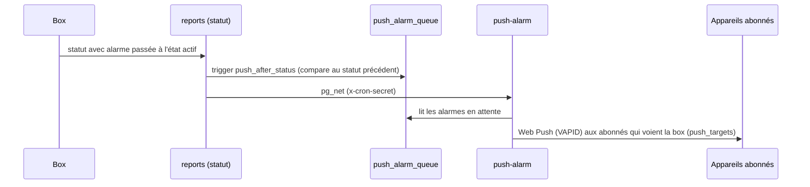

# Flux : alarmes, notifications, mails et rapports

Quatre mécanismes distincts, à ne pas confondre :

| Mécanisme | Déclencheur | Canal | Qui l'envoie |
|---|---|---|---|
| Alarmes de la box (mail/SMS/appel, escalade) | la **box** | selon sa configuration | la box elle-même ; le portail ne fait que **configurer** |
| Notifications push | un statut où une alarme devient active | Web Push (PWA) | `push-alarm` |
| Perte / retour de liaison | cron 15 min | mail | `cron-connectivity-alerts` |
| Mail de statut | cron | mail | `cron-status-email` |
| Rapport programmé | cron 15 min | mail + archive | `report-run` |

## 1. Alarmes configurées depuis le portail

Les listes de destinataires et l'escalade vivent **sur la box** ; le portail les édite à distance.

- Tables : `alarm_subscriptions` (qui reçoit les alarmes de quelle box, avec filtres de gravité `info`/`warning`/`error`, canaux et jours), `device_escalation` (configuration d'escalade et état de référence `baseline`), `recipients.alarm_*` (réglages par défaut d'une personne).
- Le portail écrit ces réglages puis les envoie par la **file de commandes** (`queue_alarm_sync` → commandes `set_recipients` / `set_escalation`, voir [ingestion.md](ingestion.md)).
- Si la liste a été modifiée sur la box, les hachages `recipients_hash` / `escalation_hash` diffèrent de leur référence et le portail propose l'import (`import_alarm_config`).
- Écrans : `app/src/views/admin/AlarmRecipientsView.vue`, `components/alarms/*` (`BoxAlarmPanel`, `EscalationEditor`, `BoxNotificationsPanel`, `AlarmPreview`), composable `useAlarmConfig.ts` (600 lignes). Logique d'aperçu : `composables/alarmPreview.ts` (testée).
- Identifiant court `box_recipient_id` (8 caractères hexadécimaux) : identifie le destinataire dans la configuration de la box.

### Voir et traiter les alarmes
- `alarm_counts` et `alarm_history` (RPC) alimentent `AlarmsView.vue` ; l'historique long est lu dans les Parquet par `ts-read` (mode `alarms`).
- **Retirer une alarme** (`dismiss_alarm`, table `alarm_dismissals`) : réservé à l'admin de l'entreprise ou au staff, pour une box perdue ou démontée dont le dernier statut garde une alarme active. Le retrait ne vaut que pour le statut en cours : dès que la box envoie un nouveau statut, elle fait de nouveau foi. Rien n'est supprimé.

## 2. Notifications push (PWA)

- Abonnements : `push_subscriptions` (un par navigateur / téléphone, ajouté depuis `PushAlarmsToggle.vue` et `composables/usePushAlarms.ts`).
- Clé publique côté front : `VITE_VAPID_PUBLIC_KEY` ; côté fonction : les trois variables `VAPID_*` (clé publique, clé privée, sujet).
- Le service worker `app/public/sw.js` affiche la notification et ouvre la box concernée au toucher.
- Abonnement expiré (réponses 404/410) : supprimé par la fonction.
- L'URL de `push-alarm` est déduite de celle de `ts-build` (Vault `ts_build_url`).

## 3. Perte et retour de liaison

- `cron-connectivity-alerts`, toutes les 15 min. Une box est « perdue » si elle n'a rien envoyé depuis `companies.connectivity_delay_minutes` (30 min, 1 h ou 4 h selon le réglage) ; état mémorisé dans `connectivity_alerts` (`lost`/`recovered`) pour n'envoyer qu'**une fois** par transition.
- Réglages par entreprise (`connectivity_alerts_enabled`, délai), destinataires choisis box par box (`connectivity_subscriptions`), **mode maintenance** par box (`devices.alerts_paused_until`, RPC `set_device_alerts_pause`).
- Un seul mail par personne et par passage, regroupant toutes les box. Calcul des transitions dans `supabase/functions/cron-connectivity-alerts/logic.ts`.
- Sans configuration Gmail (projet TEST) : aucun envoi, réponse `dry_run`. `ALERT_MAIL_ALLOW_DOMAIN` restreint les destinataires.
- Écran : `components/alarms/BoxNotificationsPanel.vue` (RPC `set_company_notifications`, `connectivity_subscribe_all`).

## 4. Mail de statut

- `cron-status-email` : récapitulatif d'état des box d'une entreprise ; fréquence `companies.status_email_frequency` (`none`/`daily`/`weekly`), jour `status_email_weekday`, résumé rédigé par IA si `status_email_ai` (secret `GEMINI_API_KEY`), destinataires `recipients.status_email`.
- Peut être déclenché à la main pour une entreprise depuis l'écran staff (`views/admin/staff/CompanyDetailView.vue`).
- Planification : à créer à la main selon `supabase/cron-setup.md` (pas dans une migration). Attention à l'heure d'été/hiver : le cron est en UTC.

## 5. Analyse de dérive (insights)

`ts-build` appelle `analyze-report` après avoir construit un jour. La fonction compare la moyenne journalière de chaque mesure à ses 28 jours précédents (z-score robuste), confirme sur 7 jours, détecte les tendances lentes sur 12 semaines, puis écrit `report_insights`. Le portail affiche les nouveautés dans `components/devices/InsightsPopup.vue` (composable `useDeviceInsights.ts`) ; l'acquittement et le report d'affichage sont dans `recipient_device_views`.

## 6. Rapports programmés

- Un **modèle** (`report_templates`) lie un tableau de bord à une fréquence (`daily`, `weekly`, `monthly`), une heure, un fuseau (`Europe/Paris` par défaut), une comparaison (`none`, `previous`, `year`), des destinataires, et des pièces jointes CSV / PDF.
- Le cron `report-run` (toutes les 15 min) traite les modèles dont `next_run_at` est échu. Il **attend** que les rapports journaliers des box couvrent la période (jusqu'à `REPORT_WAIT_HOURS`, 6 h par défaut), sinon envoie avec la mention « données incomplètes ».
- Chaque exécution laisse une ligne `report_runs` (`sent`, `not_sent`, `error`) et des fichiers dans le bucket `reports`. Sans configuration Gmail : statut `not_sent` (rapport archivé quand même).
- Écran : `components/dashboard/ReportsPanel.vue`, composable `useReports.ts` (aperçu `preview`, envoi immédiat `run`).
- Envoi des mails : `_shared/mailer.ts` (API REST Gmail, pas SMTP).
