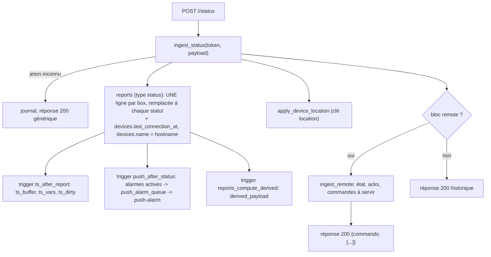
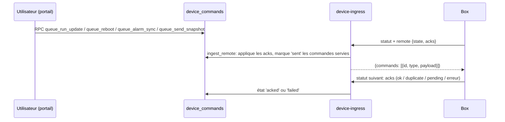

# Flux : ingestion des données des box et commandes descendantes

Le contrat côté box (enregistrement, jeton, adresses, pièges du firmware) est dans [`docs/device-provisioning.md`](../device-provisioning.md) ; le format du statut dans [`docs/reference/status-payload-schema.md`](../reference/status-payload-schema.md). Cette page décrit ce que fait **le portail** de ces messages.

## Adresses

Les box appellent `https://api.hexa-ai.fr` (alias du site Netlify). `netlify.toml` relaie, sans modifier le corps ni l'en-tête `Authorization` :

| Entrée | Destination |
|---|---|
| `api.hexa-ai.fr/ingress/*` | `device-ingress/ingress/*` |
| `api.hexa-ai.fr/provision/*` | `device-ingress/provision/*` |
| `api.hexa-ai.fr/*` | `device-ingress/*` (la fonction répond 404/405 elle-même) |
| `my.hexa-ai.fr/api/device-ingress/*` | `device-ingress/*` (essais avant le DNS) |

Ces règles doivent rester **avant** la règle `/*` de l'application.

## Routes de `device-ingress` (`supabase/functions/device-ingress/index.ts`)

| Route | Corps / en-tête | Effet |
|---|---|---|
| `POST /provision/<hostname>` | `{mac}` | RPC `provision_device` : 200 `{token, id, name}` ; 400 MAC invalide ; 404 box inconnue ; 410 déjà provisionnée |
| `POST /<hostname>/status` | statut 30 min, `Authorization: Bearer <jeton box>` | RPC `ingest_status`, puis position 4G (`apply_device_location`), puis, si le message contient un bloc `remote`, RPC `ingest_remote` |
| `POST /<hostname>/report/daily` | rapport journalier | RPC `ingest_report`, puis position 4G |
| `POST /<hostname>/report/weekly` ou `monthly` | — | acceptés puis **ignorés** (accusé de réception seul) |
| `POST /<hostname>/realtime-token` | Bearer | jeton du direct (voir [temps-reel.md](temps-reel.md)) |

Le préfixe `/ingress/` (hérité de n8n) est accepté partout. `GET` et autres méthodes : 405.

## Pourquoi presque tout répond 200

C'est voulu et commenté dans l'en-tête du fichier : l'ancien flux n8n répondait 200 avant tout traitement. Or le firmware, sur 401/403, **efface son jeton et se ré-enregistre**, puis reçoit 410 (« déjà provisionnée ») et reste bloqué. Donc :

- jeton inconnu, JSON invalide, erreur interne : **200** avec le corps `{"message":"Workflow was started"}` (copie de l'ancienne réponse n8n), l'erreur est seulement journalisée ;
- seule exception : `realtime-token` répond **401** sur jeton refusé, car la box ne doit pas effacer son jeton sur cette route ;
- la réponse doit être un **objet JSON, pas un tableau** (« piège n°1 » de la doc firmware).

> Ne « corrigez » pas ce comportement sans mettre à jour le firmware des box.

## Étapes de l'ingestion d'un statut

Pour le rapport journalier (`ingest_report`) : écriture dans `reports` avec `period_start`/`period_end` (déduits de `metadata.period_str`, format « JJ/MM/AAAA hh:mm → JJ/MM/AAAA hh:mm »), contrôle de quota (`companies.max_daily_reports`), puis `ts_after_report` marque les jours dans `ts_dirty` et appelle `ts-build` (asynchrone), qui construit l'historique Parquet puis lance `analyze-report` (voir [edge-functions.md](../backend/edge-functions.md)).

## Commandes descendantes (portail → box)

Il n'y a pas de connexion entrante vers la box : le portail dépose des ordres dans `device_commands` et **la box les récupère dans la réponse à son statut**, si elle a activé « Enable remote management » (envoi du bloc `remote`).

- Types de commande (contrainte SQL de `device_commands.type`) : `set_recipients`, `set_escalation`, `run_update`, `reboot`, `send_snapshot`.
- États (`device_command_state`) : `queued` → `sent` → `in_progress` (ack `pending`) → `acked` (ack `ok` ou `duplicate`) ou `failed` ; `cancelled` (annulation par `cancel_device_command`, possible seulement pour `run_update` et `reboot` encore en file).
- `ingest_remote` met aussi à jour l'état de la box : `remote_protocol`, `remote_seen_at`, `running_version`, `pkg_version`, `candidate_version`, `reboot_required`, et les hachages `recipients_hash`/`escalation_hash`. Un écart entre le hachage courant et le hachage de référence signifie que la liste a été modifiée sur la box ; l'écran d'alarmes propose alors de l'importer (`import_alarm_config`).
- L'écran des mises à jour (`app/src/views/admin/UpdatesView.vue`) lit `firmware_releases` (rempli par `cron-firmware-releases`) et appelle `queue_run_update` / `cancel_device_command`.
- Le droit de lire `device_commands` suit `is_device_visible` ; l'écriture ne passe que par les RPC.

## Ce qui peut mal tourner

| Symptôme | Cause probable |
|---|---|
| la box ne remonte plus rien mais reçoit 200 | jeton inconnu : l'ingestion est ignorée silencieusement ; regarder les journaux de la fonction (`ingress status: jeton inconnu`) |
| rapport journalier absent | quota `max_daily_reports` à 0 ou jeton inconnu (`ingress report: rien écrit`) |
| historique en retard | `ts_dirty` non vidé : `ts-build` non appelé (secrets Vault absents) ; il rattrape au passage du cron s'il existe |
| commande qui reste `queued` | la box n'envoie pas le bloc `remote` (gestion à distance désactivée) |
