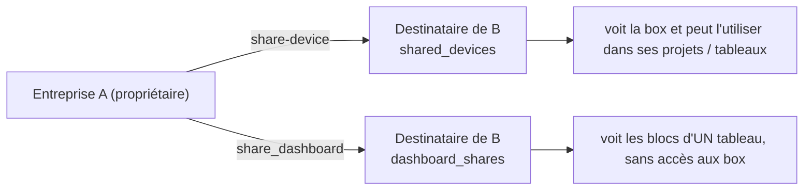

# Flux : partage entre organisations

Besoin : une entreprise doit pouvoir **voir des box qui appartiennent à une autre** (un exploitant, un sous-traitant) sans lui ouvrir toutes ses données. Le dépôt propose trois niveaux. Source : `supabase/migrations/20261028120000_partage_tableaux.sql` (MYH-010) et les fonctions `share-device`, `invite-recipient`.

## 1. Partager une box avec une personne : `shared_devices`

- Colonne `recipients.shared_devices uuid[]` : box d'**autres** entreprises que ce destinataire peut voir. Elle entre dans la règle `is_device_visible` (voir [securite-rls.md](../backend/securite-rls.md)).
- Edge Function `share-device` (`POST {device_id, recipient_email}`) : ajoute la box à la liste. Droits : admin de l'entreprise **propriétaire** de la box, ou staff Hexa admin. Appelée par `app/src/views/admin/DeviceDetailView.vue`.
- **Pas de re-partage** : une entreprise ne peut partager que ses propres box (`DeviceDetailView.vue` le rappelle dans un commentaire).
- `invite-recipient` accepte aussi `shared_devices` à la création, mais **réservé au staff** pour des box hors de son entreprise.
- Cas du « invité pur » : un destinataire sans entreprise (`company_id = null`), créé par le staff, doit avoir au moins une box partagée.

## 2. Restreindre une personne dans sa propre entreprise : `restrict_to_devices`

`recipients.restrict_to_devices uuid[]` : si non vide, la personne ne voit que ces box de son entreprise (au lieu de toutes). Un admin d'entreprise peut la renseigner parmi les box de son entreprise.

## 3. Utiliser des box reçues dans ses projets et tableaux

Une organisation qui reçoit une box partagée peut la ranger dans **ses** projets (table `project_devices`, une box dans au plus un projet par organisation) et l'utiliser dans **ses** tableaux de bord. Les tableaux appartiennent à l'organisation qui les construit ; les données restent protégées par `is_device_visible`. Si le partage est retiré, plus rien ne s'affiche, sans nettoyage à faire.

RPC : `set_devices_project`, `remove_device_from_project`, `projects_overview`, `project_device_ids`, `device_shared_with_company`.

## 4. Partager un tableau en lecture seule : `dashboard_shares`

- Table `dashboard_shares (dashboard_id, recipient_id)`. RPC : `share_dashboard`, `unshare_dashboard`, `dashboard_shares_list` (côté propriétaire), `shared_dashboards_for_me`, `shared_dashboard_bundle` (côté destinataire).
- Le destinataire voit les **blocs** du tableau, jamais la fiche des box. Les mesures sont lues via `ts-read` avec le paramètre `dashboard` : l'accès est limité aux box du tableau et aux variables de ses blocs (`dashboard_read_grant`).
- Ne peuvent être partagés que les tableaux dont **toutes les box** appartiennent à l'organisation propriétaire (pas de re-partage d'une box reçue) ; la validité est **revérifiée à chaque lecture** (`dashboard_share_valid`) : une box revendue ou changée d'organisation coupe l'accès.
- Front : route `/admin/dashboard/partage/:d` (`SharedDashboardView.vue`), composable `useDashboards.ts`, panneau `components/dashboard/DashboardSharePanel.vue`.
- Sécurité : les nouvelles tables ne s'écrivent que par des fonctions `security definer` qui vérifient les droits ; `save_dashboard_widgets` refuse une source hors du périmètre du tableau ou non visible.

