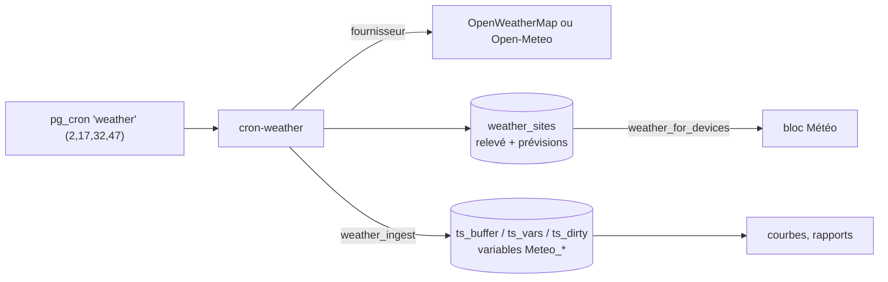

# Flux : position 4G et météo

## Position 4G de la box

**But** : remplacer les coordonnées saisies à la main par la position approximative donnée par la cellule 4G de la box (carte de la flotte, météo, projets).

Fichiers : `supabase/functions/_shared/location.ts` (analyse), `supabase/functions/device-ingress/index.ts` (fonction `applyLocation`), `supabase/migrations/20261031110000_position_box.sql` (tables et RPC), `app/src/views/admin/FleetMapView.vue`, `app/src/components/DeviceMap.vue` (affichage).

### Contrat côté box
La box ajoute au premier niveau de son **statut 30 min** et de son **rapport journalier** une clé :

```json
"location": { "latitude": 45.1, "longitude": 4.8, "accuracy_m": 800, "source": "cell", "approximate": true, "resolved_at": "2026-10-30T08:00:00Z" }
```

ou `null` / clé absente = rien n'est changé (ancienne box, ou géolocalisation désactivée). (Les valeurs ci-dessus sont des exemples.)

### Règles de `parseLocation` (`_shared/location.ts`)
- clé absente ou `null` → ignorée sans erreur ;
- clé invalide → ignorée et journalisée (jamais d'échec d'ingestion) : latitude/longitude non numériques, hors bornes (±90 / ±180), ou **0,0** ;
- `accuracy_m` gardé s'il est entre 0 et 10 000 000, arrondi ;
- `resolved_at` dans le futur (horloge de la box fausse) ramené à l'instant de réception ;
- `source` limitée à 20 caractères (défaut `cell`), `approximate` vrai sauf si la box dit `false`.
- Tests : `supabase/functions/_shared/location_test.ts`.

### Ce que fait la base
- RPC `apply_device_location(p_device, p_loc, p_at)` : **remplace** les coordonnées de `devices` (choix de produit), renseigne `location_source`, `location_accuracy_m`, `location_at`, et retourne `{applied, reason, history}`.
- Historique `device_locations` : une ligne seulement si la box a bougé de plus de 50 m ou si la dernière ligne a plus de 24 h.
- Une **saisie manuelle** des coordonnées (trigger `devices_location_manual`) remet `location_source` à `manual` jusqu'au prochain envoi de la box.
- `devices_with_latest_status` expose l'origine, la précision et la date de la position.

## Météo à l'adresse des box

Fichiers : `supabase/functions/cron-weather/index.ts`, `supabase/functions/_shared/weather.ts` (+ `weather_test.ts`), migrations `20261030090000_meteo.sql` et `20261030091000_meteo_reprise.sql`, front `app/src/components/dashboard/WeatherBlock.vue`, `WeatherIcon.vue`, `app/src/composables/useWeather.ts`.



- **Site** : coordonnées de la box (sinon du projet), arrondies à 0,01° (~1 km) ; les box d'un même site partagent le relevé (`weather_site_key`, `weather_device_sites`). Seules les box localisées et vues ces 7 derniers jours sont prises en compte.
- **Fréquence** : relevé toutes les 15 min (décalé de 2 min), prévisions rafraîchies toutes les 3 h.
- **Fournisseur** : OpenWeatherMap si `OPENWEATHER_API_KEY` est défini, sinon Open-Meteo (offre gratuite = usage non commercial, donc pour les essais ; en production, `OPEN_METEO_API_KEY` ou OpenWeatherMap). Variable `WEATHER_PROVIDER` pour forcer. Aucune clé n'est renvoyée ni journalisée.
- **Historique** : les mesures sont versées dans l'historique de chaque box comme ses propres variables (`Meteo_Temperature`, `Meteo_Humidite`…), catégorie `weather` : on peut les tracer et les superposer. La catégorie `weather` est **ignorée** par l'analyse de dérive (qui ne lit que `measure` et `counter`).
- **Droits** : `weather_sites` n'a aucune politique ; la lecture passe par `weather_for_devices`, qui filtre sur les box visibles ; l'écriture est réservée à la clé de service.
- **Bloc Météo** : vues « maintenant », « 24 h », « 5 jours » ; contenu au choix (`options.weatherFields`), pictogrammes animés ou fixes (`options.weatherIcons`).
- `20261030091000_meteo_reprise.sql` : reprise d'un passé récent (Open-Meteo `past_days`) en un appel par site.
