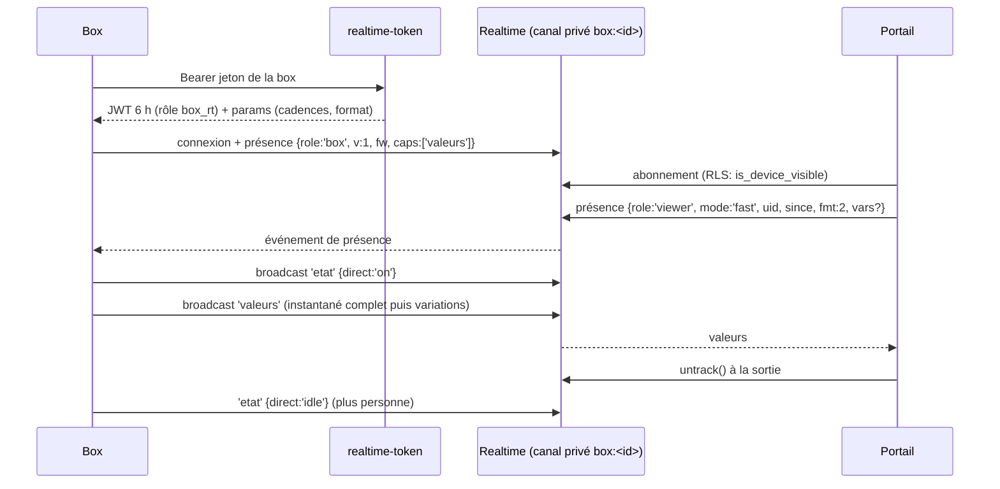

# Flux : le direct temps réel

Par défaut le portail affiche les valeurs du **statut toutes les 30 minutes**. Le **direct** les affiche toutes les ~2 s en passant par Supabase Realtime, sans stocker les valeurs. Il est apparu en octobre 2026 ; sa conception complète (contrat de protocole, protocole de test, mesures) est conservée hors dépôt par l'équipe ; cette page en est le résumé, sans aucun secret.

Fichiers clés :

| Côté | Fichier |
|---|---|
| base | `supabase/migrations/20261031090000_realtime_direct.sql` (rôle `box_rt`, droits sur `realtime.messages`, `device_realtime`, `realtime_box_lookup`) + `20261031120000_realtime_box_rt_droits.sql` (droits rejoués, `box_rt` membre d'`authenticator`) |
| jeton box | `supabase/functions/realtime-token/index.ts`, `supabase/functions/_shared/realtimeToken.ts`, route `/<hostname>/realtime-token` de `device-ingress` |
| front : état | `app/src/stores/live.ts` (store Pinia partagé) |
| front : transport | `app/src/lib/live/` (`index.ts`, `types.ts`, `supabaseSource.ts`, `mockSource.ts`) |
| front : interface | `app/src/components/dashboard/LiveControl.vue` (l'« œil »), `LiveBanner.vue` (« Continuer le direct ? ») |
| affichage permanent | colonne `dashboards.live_display` (`20261031100000_dashboards_live_display.sql`), `app/src/views/admin/DashboardView.vue` (variable `kiosk`) |

## Principe



La box ne publie **que s'il y a au moins un spectateur** : tant que personne ne regarde, elle n'envoie qu'un battement de cœur (économie de data 4G).

## Canal et droits

- Un canal **privé** par box : topic `box:<devices.id>`.
- Un utilisateur authentifié peut lire (broadcast + présence) et annoncer sa présence sur `box:<id>` **si `is_device_visible(<id>)`**, c'est-à-dire la même règle que pour voir la box dans le portail. Un client anonyme est refusé (canaux privés obligatoires sur le projet).
- La box utilise un JWT court de rôle `box_rt`, qui ne donne accès **qu'à son propre topic** (`select` + `insert` sur `realtime.messages`). `box_rt` est membre d'`authenticator` (indispensable pour que Realtime accepte le jeton) mais n'a aucun droit sur le schéma `public` : l'API de données répond 403 (test de sécurité T20). Attention : activer `private_only` peut faire perdre le grant sur `realtime.messages`, la migration `20261031120000` le rejoue.
- Le jeton est signé en HS256 avec le secret JWT du projet, fourni à la fonction par le secret `RT_JWT_SECRET`. Si le projet passe aux clés de signature asymétriques, la signature devra changer (ES256).
- Durée de vie : 6 h par défaut (`RT_TOKEN_TTL_S`). Une box mise au rebut garde au plus 6 h l'accès à **son** canal ; le renouvellement est refusé tout de suite. La box renouvelle aux 2/3 (`renew_after`).
- Frein anti-essai : 30 échecs par minute et par IP (par instance de la fonction).

## Messages

Tous portent une version `v` ; **ignorer les champs inconnus**.

**`valeurs` v1** : `{v:1, seq, t, full, mode, d:{nom:[valeur, ts_ms]}}`. `full:true` = instantané complet à fusionner, `false` = variables modifiées seulement. `seq` croît à chaque message depuis la connexion de la box (une chute = reconnexion). `t` = horodatage d'émission (latence).

**`valeurs` v2 (compact)** : `{v:2, e, s, t, f?, k?, d:[index, valeur, index, valeur, …]}`.
- `k` : dictionnaire `index → nom`, envoyé **une fois** (dans chaque instantané `f:1` et à la première apparition d'une variable) ;
- `e` : époque du dictionnaire (change au redémarrage du service de la box) ; le portail garde un dictionnaire par canal **et** par époque, et ignore un index inconnu jusqu'au prochain instantané ;
- plus d'horodatage par valeur : on utilise `t`.
- Le décodeur est dans `app/src/lib/live/supabaseSource.ts` (`createValuesDecoder`).

**`etat`** : `{v:1, t, direct:'on'|'pause'|'idle', mode}`. `pause` = limite de 15 min atteinte en direct rapide : le portail affiche « Continuer le direct ? ».

**`cmd` / `ack`** : réservés pour des ordres descendants futurs ; aujourd'hui la box répond `ack unsupported`. Le portail ne publie rien (la RLS l'interdit).

## Présence

**Box** : `{role:'box', v:1, fw:'<version>', caps:['valeurs']}`, clé de présence = `devices.id`. Elle n'apparaît que lorsqu'elle est connectée à Realtime. Pour le front, « une entrée avec `role === 'box'` » veut dire : box en ligne **et** capable de direct. Son absence veut dire hors ligne **ou** ancien firmware : le portail affiche « Direct indisponible » et garde les données 30 min.

**Spectateur** (annoncé par `app/src/stores/live.ts`) :

```ts
{ role: 'viewer', mode: 'fast' | 'slow', since: <ms>, fmt: 2, vars?: string[] }
```

| Champ | Sens |
|---|---|
| `role` | **obligatoire** : `viewer` (la box ignore les autres) |
| `mode` | `fast` (~2 s, limité à 15 min) ou `slow` (~10 s, sans limite) ; `fast` l'emporte sur `slow` s'il y a les deux |
| `since` | instant de l'annonce ; le compteur des 15 min part de là |
| `fmt` | `2` = « je comprends le format compact » ; la box n'utilise v2 que si **tous** les spectateurs présents l'annoncent et que le serveur l'autorise (`params.fmt`) |
| `vars` | liste des variables affichées ; la box ne publie que l'**union** des listes (sans `vars` = toutes). Changer la liste déclenche un instantané |

La clé de présence est un identifiant propre à l'onglet (`TAB_KEY`) : deux onglets = deux spectateurs. Un nouveau spectateur déclenche un instantané pour tous ; « Continuer » (même clé) n'en déclenche pas.

## Paramètres pilotés par le serveur (`params` de `realtime-token`)

Modifiables sans mettre à jour le firmware (`_shared/realtimeToken.ts`) : `heartbeat_s: 60` (ping WebSocket), `fast_interval_ms: 2000`, `fast_deadband_pct: 0.1`, `slow_interval_ms: 10000`, `slow_deadband_pct: 0.5`, `sig_digits: 5` (arrondi des flottants sans toucher à la partie entière), `fmt: 2`, `max_msgs_per_s: 2`, `max_direct_s: 900`.

## Côté front : règles du store `live.ts`

- Par défaut rien ne change : tuiles et graphiques restent sur les statuts 30 min.
- L'« œil » démarre le direct **rapide** pendant `FAST_DURATION_MS` (15 min, `lib/live/index.ts`), puis arrête et propose « Continuer le direct ? ». L'onglet caché met en pause (le compteur ne tourne pas).
- L'**affichage permanent** (tableau avec `live_display` et au moins une box capable) utilise la cadence **lente**, sans limite ni bandeau.
- **Un seul canal par box**, compté par références ; il se ferme dès que plus personne n'en a besoin.
- Reconnexion avec délai exponentiel et jitter.
- Historique glissant en mémoire : 65 min (`TRAIL_MS`) et 4 500 points au plus par variable (`TRAIL_MAX_POINTS`).
- Les erreurs d'annonce sont absorbées : un échec Realtime ne casse jamais la page, qui retombe sur les valeurs 30 min.
- Interrupteurs de build : `VITE_REALTIME_DIRECT=false` coupe tout le direct ; `VITE_LIVE_SOURCE=mock` utilise `mockSource.ts` (développement sans backend) ; `VITE_LIVE_FAST_MS` raccourcit les 15 min (tests).

## Coût en data 4G (mesures sur le projet TEST, 200 variables simulées)

| Situation | Avant optimisation | Après |
|---|---|---|
| Repos (battement seul) | ≈ 50 ko/h | ≈ 16,5 ko/h |
| Direct rapide, 200 variables affichées | 24 200 ko/h | ≈ 1 970 ko/h |
| Direct rapide, 40 variables (tableau type) | — | ≈ 880 ko/h |
| Affichage permanent (10 s), 200 variables | 1 550 ko/h | ≈ 480 ko/h |

Mois type (repos + 2 sessions de 15 min par jour ouvré) : environ 22 Mo à 40 variables (contre 300 Mo avant optimisation). Gains obtenus par : battement WebSocket de 60 s, jeton de 6 h, cadence de 2 s, bande morte, arrondi à 5 chiffres, format v2 avec dictionnaire, publication limitée aux variables affichées (`vars`).

## Compatibilité

- Ancien portail (sans `fmt`) + nouveau firmware : la box publie du v1.
- Ancien firmware : ignore les nouveaux paramètres (heartbeat 60 s, cadence 2 s) et publie du v1.
- Les deux versions doivent donc rester décodables côté front.

## Pièges

- Ne **pas** redéployer `device-ingress` depuis une branche qui ne contient pas la route `realtime-token` : la box perdrait son accès au direct.
- La première mise en production du direct exige aussi que les canaux privés soient exigés (`private_only`) sur le projet Realtime et que le secret `RT_JWT_SECRET` existe : voir [exploitation](../exploitation/README.md).
